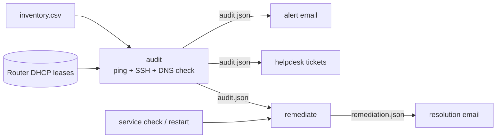

# dns-audit-toolkit

Find, report and fix Linux hosts that have stopped using your trusted DNS servers.

A rogue resolver is a quiet but serious compromise: every lookup a host makes can be redirected.
This toolkit automates the whole incident response, from discovery to the "all clear" email:

1. **Audit:** resolve every host's current IP (including DHCP clients, from the router's live lease table),
   ping it, SSH in and work out which DNS servers it *actually* uses.
2. **Alert:** email the affected hosts and open one helpdesk ticket per host through a REST API.
3. **Service:** check the DNS service (BIND / unbound) on your DNS servers and restart it if it is down.
4. **Remediate:** back up the rogue resolver config and point each host back at the trusted servers, then re-verify.
5. **Resolve:** email the list of hosts that were fixed.



## Design choices

- **Discover, don't assume.** Nothing about the network's current state is hardcoded. DHCP addresses come from the
  router at run time, DNS settings are read from each host, and every step consumes the previous step's JSON results.
- **Look past the stub resolver.** `nameserver 127.0.0.53` only means systemd-resolved is in use. The audit follows it to
  the real upstream servers (`resolvectl dns`, falling back to `/run/systemd/resolve/resolv.conf`).
  "One trusted + one rogue" is still flagged.
- **Safe by default.** `remediate` is a dry run unless you pass `--apply`. The original file is kept as evidence before
  anything changes, and every fix is re-verified with the same check the audit uses.
- **No secrets in files.** Passwords and API tokens are read from environment variables named in the config or
  inventory. SSH keys or an agent are used when no password is set.

## Quick start

```bash
python -m venv .venv && source .venv/bin/activate
pip install -r requirements.txt

cp config.example.toml config.toml        # trusted DNS servers, SMTP, ticket API
cp inventory.example.csv inventory.csv    # your hosts ("dhcp" as the address for DHCP clients)

export DNSAUDIT_SSH_PASSWORD='...'        # or rely on SSH keys
export DNSAUDIT_ROUTER_PASSWORD='...'
export DNSAUDIT_TICKET_TOKEN='...'

python -m dns_audit audit                 # exit code 1 if any host is affected
python -m dns_audit alert --dry-run       # preview, then run without --dry-run
python -m dns_audit tickets
python -m dns_audit service --restart
python -m dns_audit remediate             # dry run: shows what would change
python -m dns_audit remediate --apply     # or: remediate --apply ws1 db1
python -m dns_audit resolved
```

## Inventory format

| column | example | notes |
|---|---|---|
| name | `ws1` | must match the router's DHCP lease hostname for DHCP clients |
| address | `10.0.2.10` or `dhcp` | |
| role | `host`, `dns`, `router`, `skip` | `host` and `dns` are audited |
| os | `linux`, `vyos` | |
| username | `netops` | |
| password_env | `DNSAUDIT_SSH_PASSWORD` | name of an environment variable, never the password itself |

## Example audit output

Illustrative output with documentation IP ranges:

```
==========================================================================================
DNS audit    2026-01-01 10:00:00
==========================================================================================
Trusted DNS: 10.0.0.53, 10.0.1.53   Targets: 6   Skipped: router1, switch1
DHCP leases from router1: 2 active
  dns1       10.0.0.53        static          UP    10.0.1.53                      OK
  dns2       10.0.1.53        static          UP    10.0.0.53                      OK
  app1       10.0.2.10        static          UP    10.0.0.53, 10.0.1.53           OK
  db1        10.0.2.20        static          UP    198.51.100.7                   COMPROMISED
  ws1        10.0.10.100      dhcp-lease      UP    10.0.0.53, 10.0.1.53           OK
  ws2        10.0.10.102      dhcp-lease      UP    198.51.100.7                   COMPROMISED

Affected: 2 of 6
  [ALERT] db1 (10.0.2.20): untrusted DNS server 198.51.100.7
  [ALERT] ws2 (10.0.10.102): untrusted DNS server 198.51.100.7
```

## Tests

The parsing and classification logic is covered by unit tests that need no network:

```bash
python -m unittest discover -s tests -t . -v
```

## Requirements

Python 3.10+, `paramiko`, `netmiko` (only for reading VyOS DHCP leases), and `requests` (only for tickets).
Target hosts: Linux with systemd. `sudo` rights are needed for `service --restart` and `remediate --apply`.

## License

MIT - see the [LICENSE](../LICENSE) file at the repository root.
